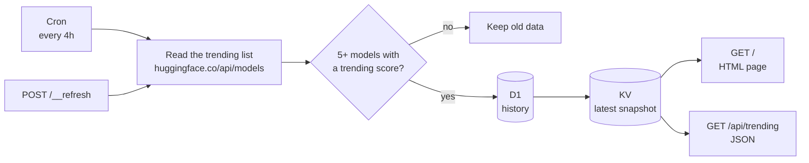

<div align="center">

# trending-models

A Cloudflare Worker that reads [Hugging Face trending](https://huggingface.co/models) every 4 hours and tracks how many days each model has trended.

[](https://models.ddewhurst.com)
[](https://workers.cloudflare.com)
[](https://www.typescriptlang.org)
[](LICENSE)

</div>

---

A sibling of [trending-repos](https://github.com/forjd/trending-repos), which does the same for GitHub trending. Both pages share one design: a printed singles chart.

## What it does

- Reads the 30 top models by trending score from the Hugging Face API on a cron trigger every 4 hours. This is the list that [huggingface.co/models](https://huggingface.co/models) shows first.
- Shows each model's task, parameter count, likes, downloads, library, license and creation date, with a bar that compares its trending score to the top score.
- Stores every refresh in D1, so each model can carry a **New today** or **Trended on N days** badge. Hugging Face's internal model id survives renames, so a renamed model keeps its history.
- Renders the page from a single KV read, with ETags and caching. The page has no client-side JavaScript and follows your system's light or dark mode.
- Serves the same snapshot as JSON at [`/api/trending`](https://models.ddewhurst.com/api/trending).
- Keeps the previous snapshot if the API fails, or returns fewer than 5 models or no trending scores.
- Shows a notice on the page when the data is more than 12 hours old, and can ping a [Healthchecks.io](https://healthchecks.io) check after each cron run.

## How it works



Page loads only touch KV. D1 is written and queried only during a refresh.

| Route | Returns |
|---|---|
| `GET /` | The styled HTML page |
| `GET /api/trending` | The latest snapshot as JSON |
| `POST /__refresh` | Runs a refresh now. Needs `Authorization: Bearer <REFRESH_KEY>` |

## Getting started

You need Node.js and a Cloudflare account.

```bash
git clone https://github.com/danjdewhurst/trending-models.git
cd trending-models
npm install
```

### Run locally

```bash
npm run db:migrate:local   # create the local D1 schema
npm run dev                # http://localhost:8787
curl localhost:8787/__scheduled   # trigger a refresh
```

The Hugging Face API works without a token. To set one, and a `REFRESH_KEY` for `/__refresh`, create `.dev.vars`:

```ini
REFRESH_KEY=some-long-random-string
HF_TOKEN=hf_...                           # optional, a read-only token
HEALTHCHECK_URL=https://hc-ping.com/...   # optional
```

### Deploy your own

1. Create a KV namespace and a D1 database, and put their ids in `wrangler.jsonc` in place of the ids there now (they belong to the live site):
   ```bash
   npx wrangler kv namespace create trending-models
   npx wrangler d1 create trending-models
   ```
2. Change or remove the custom domain in `wrangler.jsonc` (`routes`) and `SITE_URL` in `src/render.ts`.
3. Set the secrets:
   ```bash
   npx wrangler secret put REFRESH_KEY
   npx wrangler secret put HF_TOKEN          # optional
   npx wrangler secret put HEALTHCHECK_URL   # optional
   ```
4. Deploy. This applies the D1 migrations first:
   ```bash
   npm run deploy
   ```
5. Run the first refresh, so the page has data before the next cron run:
   ```bash
   curl -X POST -H "authorization: Bearer <REFRESH_KEY>" https://<your-worker>/__refresh
   ```

To deploy on every push to `main`, add `CLOUDFLARE_API_TOKEN` and `CLOUDFLARE_ACCOUNT_ID` secrets to a GitHub environment called `production`, and set the repository variable `DEPLOY_ENABLED` to `true`.

## Development

```bash
npm run typecheck   # tsc --noEmit
npm test            # Vitest in the Workers runtime, with local KV and D1; fetch is mocked
npm run types       # regenerate worker-configuration.d.ts after changing wrangler.jsonc
npm run og          # regenerate public/og.png (needs google-chrome)
```

[AGENTS.md](AGENTS.md) has the architecture, the data model and the known gotchas.

## License

[MIT](LICENSE). The fonts in `public/fonts` are under the SIL Open Font License; their licences sit beside them.

Not affiliated with Hugging Face.
